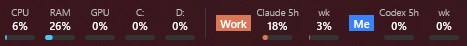

# CCT (claude-codex-taskbar): Claude Code & Codex usage limits on the Windows 11 / 10 taskbar

[](https://github.com/chiarorosa/claude-codex-taskbar/actions/workflows/ci.yml)
[](https://github.com/chiarorosa/claude-codex-taskbar/releases/latest)
[](https://github.com/chiarorosa/claude-codex-taskbar/releases)
[](LICENSE)


**A Windows 11 and Windows 10 taskbar widget that shows your Claude Code and OpenAI Codex subscription usage (5-hour and weekly limits) next to a CPU, RAM, GPU and disk monitor.** One native `.exe` under 1 MB, written in Rust. No runtime, no telemetry, no login screen: it reuses your existing `claude` / `codex` CLI login.

A tiny, always-visible strip pinned over the **left corner of the Windows taskbar** that shows, at a glance:

1. **Hardware usage**, like the *Performance* tab of Task Manager: CPU, RAM, GPU, and the active time of each physical disk.
2. **Claude Code and Codex subscription limits**: the percentage **used** of the 5-hour window and of the weekly window.

No panel to open, no window to switch to. Just glance at the taskbar.



## Status

**Early development (v0.3).** The strip, the hardware and limit readings, the tooltip, the menu, and the settings window work on Windows 11 and Windows 10. Expect rough edges; bug reports are very welcome.

## Why

Know, without interrupting your work, whether your PC is under load and how much of your AI coding quota is left before you start a big task.

## Goals

- **Truly lightweight**: a single `.exe` under 1 MB, no runtime to install, about 15 MB of RAM and near-zero CPU while running (see the [Task Manager screenshot](#how-much-memory-and-cpu-does-it-use)).
- **Standalone**: download and run. The app itself offers "Start with Windows".
- **Native**: written in Rust using raw Win32 via the [`windows`](https://crates.io/crates/windows) crate, drawn with Direct2D/DirectWrite.
- **Honest numbers**: an expired token or a broken endpoint shows a clear error state, never a fake `0%` or silently stale data.

## Features

- **Hardware items**: CPU, RAM, GPU (busiest engine, like Task Manager), and per-disk active time (one item per physical disk, labeled with its drive letters).
- **Subscription limits**:
  - **Claude Code**: 5-hour and weekly usage, using your existing `claude` CLI login. Hover for reported Opus/Sonnet weekly percentages and their local reset times, plus an extra-usage notice when enabled. Missing model readings are omitted, real `0%` is retained, and expired model windows disappear independently; retained old data keeps its stale notice. These details use the existing response, without additional requests or settings.
  - **Codex**: 5-hour and weekly usage, using your existing `codex` CLI login.
- **Toggles**: every item and every provider can be turned on or off independently. Disabled items disappear and the strip shrinks. Hidden disks are remembered by their drive letters, so changing disk numbers does not lose the setting; disks without letters use their disk number. Existing hidden-disk settings remain compatible.
- **Color cues**: progress bars turn yellow near the limit and red when close to it.
- **Hover** for a tooltip with reset times and a countdown to known future resets, last update time, and error details. The countdown follows the absolute time, e.g. `resets at 14:20 (in 1h 12m)`, using minutes, hours/minutes or days/hours and omitting a zero second unit (`1h`, `7d`).
- **Double-click** the strip to refresh the limits right away (same as **Refresh now**).
- **Right-click** for a menu: **Settings**, **Refresh now**, **Copy usage** (copies the tooltip text, handy for bug reports), **Claude account**, **Start with Windows**, **Exit**.
- **Claude account switcher**: save your paid Claude Code logins and switch between them from the right-click menu, always by hand, without `/logout` and `/login` (see [Multiple Claude accounts](#multiple-claude-accounts)).
- **Plays nice with the taskbar** (see below).

### Stays out of your way

- **Full screen:** the strip hides while a full-screen app (a YouTube video, a game, a presentation) is on the taskbar's monitor and comes back as soon as you leave full screen. Full screen on another monitor leaves it alone.
- **Display scaling:** it follows Windows display scaling (100%, 125%, 150%, …) per monitor, and stays sharp after a change.
- **Light and dark theme:** text and bar colors follow the Windows theme, switching live.
- **Language:** the interface follows the Windows display language: **English**, or **Brazilian Portuguese** when Windows is in any Portuguese variant. Other languages fall back to English. Want CCT in your language? Translations are welcome, see [`src/i18n.rs`](src/i18n.rs).
- **Taskbar icons:** it never covers the taskbar icons. When apps open and the centered icons shift, the strip shrinks (compact mode, then `…`).
- **Auto-hide and Explorer restarts:** it hides together with an auto-hidden taskbar and comes back on its own after Explorer restarts.
- **Sleep:** after resume it fetches fresh limits right away and never shows old numbers as current.

### Not planned (for v1)

- macOS or Linux support.
- A Windows Widgets board (Win+W) widget.
- Its own login screen or OAuth flow.
- Usage history or charts over time.

## Requirements

- Windows 11 or Windows 10 (x64). ARM64 is desirable but not guaranteed yet.
- No administrator privileges required.
- For the limits items: a logged-in [Claude Code](https://docs.anthropic.com/en/docs/claude-code) and/or Codex CLI on the same Windows user account.

## Installation

> Upgrading from v0.1.x (`widget-usage-windows.exe`)? Just run the new `claude-codex-taskbar.exe`: it closes the old version, keeps your settings and moves *Start with Windows* to the new executable. You can then delete the old `.exe`.

1. Download `claude-codex-taskbar-<version>-x64.zip` from the [latest release](../../releases/latest) and extract it (or grab the bare `claude-codex-taskbar.exe`). It is a single file (under 1 MB): no installer, no runtime dependencies.
2. Put it somewhere permanent (for example `%LOCALAPPDATA%\Programs\claude-codex-taskbar\`) and run it.
3. Right-click the strip → **Start with Windows** to launch it at sign-in (stored under `HKCU\Software\Microsoft\Windows\CurrentVersion\Run`).

**winget:** the package has passed Microsoft's automated validation and is awaiting moderator review ([microsoft/winget-pkgs#470599](https://github.com/microsoft/winget-pkgs/pull/470599)). Once it is approved, you will be able to install with `winget install cct`.

### Code signing

Code signing is planned through the free [SignPath Foundation](https://signpath.org/) program for open-source projects (#36). We will reapply as the project gains adoption; until then, releases are unsigned but ship SHA-256 checksums and signed build provenance (below). See the [code signing policy](CODE_SIGNING.md).

### "Windows protected your PC" (SmartScreen)

Release builds are not code-signed yet, so SmartScreen may warn about an unrecognized app. Click **More info → Run anyway**. To make sure the file is the one published here, compare its hash with `SHA256SUMS.txt` attached to the release:

```powershell
Get-FileHash .\claude-codex-taskbar.exe -Algorithm SHA256
```

To also check that it was **built by this repository's release workflow** (not just that it
matches the checksum file), verify its signed build provenance with the
[GitHub CLI](https://cli.github.com/):

```powershell
gh attestation verify claude-codex-taskbar.exe --repo chiarorosa/claude-codex-taskbar
```

The same works for the `.zip`. Releases before v0.2.1 have no attestations.

### Building from source

```powershell
cargo build --release   # target\release\claude-codex-taskbar.exe
```

See [CONTRIBUTING.md](CONTRIBUTING.md) for the toolchain setup.

## Usage

- **Free the left corner.** The strip lives where the Windows Widgets (weather) button sits. Turn that button off in *Settings → Personalization → Taskbar → Widgets*. Keep the taskbar icons **centered** (*Taskbar behaviors → Taskbar alignment*); with left-aligned icons there is no room and the strip stays hidden (the same happens on Windows 10, see the FAQ). Launching the exe again opens **Settings** while the strip is hidden.
- **Not enough room?** The strip first drops the labels (compact mode), then hides items from the end and shows `…`. Hover to see what was cut, or turn items off in **Settings**.
- **Toggle providers and items** in **Settings** (right-click → Settings). On first run, Claude and Codex are enabled automatically if their CLI login is found.
- **Notify near limit (off by default).** Enable it in **Settings** for a Windows balloon when fresh Claude/Codex usage crosses 80% or 95%. A batch shows the highest crossed threshold per window. Alerts are skipped during full-screen/presentation or when Windows is not accepting notifications; skipped crossings are not replayed later. The notification icon is temporary. Thresholds can be configured in `config.json` (`notify_thresholds`, default `[80, 95]`).
- **Claude shows `—` after a few hours?** Claude Code's login token lasts about 8 hours and is renewed only by Claude Code itself. The app never refreshes it (so it can never log the CLI out); open Claude Code and the numbers come back on the next refresh.
- **Keep login active (experimental, off by default), for Claude Code and Codex.** If you opt in (the app asks once on first run; also in **Settings**, one switch per provider), when a token has expired the app runs the CLI's own status command hidden (`claude auth status` or `codex login status`), at most every 15 minutes per provider, so the official CLI renews its own login. It sends no prompt and uses no quota. The tooltip tells you whether the renewal worked. **Feedback wanted:** please open an issue saying whether it renewed your login.
- **Codex offline?** If the endpoint fails, the strip first asks the installed Codex CLI (`codex app-server --listen stdio://`) for live limits, and if that also fails, falls back to the last limits the Codex CLI wrote to its session logs, dimmed, as long as that window has not reset yet.

### Multiple Claude accounts

Have more than one paid Claude plan (say, personal and work)? Switch between them from the strip, without `/logout` and `/login`:

1. While logged in to the first account in Claude Code, right-click the strip → **Claude account → Save current account**.
2. In Claude Code, run `/login` with the second account, then **Save current account** again.
3. From then on, pick an account under **Claude account** to switch. Claude Code picks up the new login on its next request; no restart is needed. If a task is running, or is waiting for your answer (for example on a permission prompt), the app asks first, because the rest of that task runs on the new account.

Each entry shows the plan and the usage last seen on that account. `⚠ login expires in Nd` warns that a saved login is about to expire; `⚠ needs /login` means it has, so log in with that account and save it again. Remove an account under **Claude account → Remove saved account**.

- **Paid plans only.** Pro, Max, Team and Enterprise logins can be saved. Free logins and active Claude Code trials can't.
- **Claude Code CLI only.** Switching changes the login in `~/.claude/.credentials.json`, which the `claude` CLI uses. The Claude desktop app keeps its own login elsewhere, so switching does not change the account it uses.
- **Always manual.** The app never switches on its own and never rotates accounts to get around usage limits.
- **Use only accounts that belong to you.** Sharing logins or reselling access violates Anthropic's terms.
- **How it is kept safe.** Saved logins are encrypted with Windows DPAPI for your user, in `%APPDATA%\claude-codex-taskbar\accounts\`. A switch holds Claude Code's own lock files, backs up the account being left (so its renewed token is never lost), writes through a temp file, and restores everything if any step fails. Not supported when `CLAUDE_CONFIG_DIR` is set.

## Privacy

- **No telemetry.** The app does not phone home, collect analytics, or check for updates in the background.
- **Network access is limited** to the providers' own usage endpoints, and only for the providers you enable.
- **Credentials are read-only.** The app reads `~/.claude/.credentials.json` and `~/.codex/auth.json` (respecting `CODEX_HOME`) but never writes to them, never refreshes tokens, and never competes with the official CLIs. The one exception is switching Claude accounts: only when you click *Switch*, the app writes the Claude login, under Claude Code's own locks and with a backup.
- **Credentials are never logged, copied, or sent anywhere** except to the corresponding provider's own endpoint.
- **No other programs are run**, except when the Codex HTTP endpoint fails (it queries the local `codex app-server` over stdio, hidden) or when you turn on *Keep login active*, which runs only `claude auth status` and/or `codex login status` (hidden, output discarded).
- Settings are stored locally in `%APPDATA%`.

## Disclaimer

- This project is **not affiliated with, endorsed by, or sponsored by Anthropic or OpenAI**. "Claude", "Claude Code", "Codex", and related names are trademarks of their respective owners.
- The subscription-limit data comes from **unofficial, undocumented endpoints** (the same ones the official CLIs use for their own usage/status commands). They **may change or break at any time** without notice. When that happens, the app shows an error state rather than wrong numbers.
- Use at your own risk, and make sure your usage complies with the terms of service of each provider.

## FAQ

### How do I see my Claude Code usage limits on Windows without opening a terminal?
Install this app: the taskbar shows the percentage used of your Claude Code 5-hour session window and weekly limit (the same numbers as `/usage` in Claude Code), updated every 2 minutes. Hover for the reset times.

### How do I check my Codex (ChatGPT plan) rate limits on Windows?
Same app: with the Codex CLI logged in (`codex login`), the strip shows the 5-hour and weekly percentages that `/status` reports in Codex.

### Does it need an API key or my password?
No. It reads the login that the official `claude` and `codex` CLIs already saved on your PC, read-only, and talks only to the providers' own endpoints. The only time it writes a login is when you switch Claude accounts yourself (see [Multiple Claude accounts](#multiple-claude-accounts)).

### Can I switch between two Claude Code accounts on Windows?
Yes, if both are paid plans (Pro, Max, Team or Enterprise). Save each login once from the right-click menu (**Claude account → Save current account**), then pick one to switch. Claude Code uses the new account from its next request, without a restart. Switching is always manual and applies to the `claude` CLI, not to the Claude desktop app.

### Does it work on Windows 10?
It runs on Windows 10 (x64), but the strip stays hidden there for now. Windows 10 keeps the Start button and the search box in the taskbar's left corner, so there is no free spot for the strip without covering them. Placing it next to the system tray is tracked in [#10](https://github.com/chiarorosa/claude-codex-taskbar/issues/10). Launching `claude-codex-taskbar.exe` again opens **Settings** in the running instance.

### Does it work on macOS or Linux?
No. It targets the Windows taskbar. On macOS, menu-bar apps cover the same need (see below).

### How much memory and CPU does it use?
Less than 16 MB of memory and near-zero CPU, with no disk or network activity between limit refreshes. Hardware is sampled once per second through the same performance counters Task Manager uses.


*Task Manager while running: CPU 0%, memory 14.5 MB, disk 0 MB/s, network 0 Mbps.*

## Alternatives and related tools

| Tool | Platform | What it shows |
|---|---|---|
| **claude-codex-taskbar** (this) | Windows 11 / 10 taskbar | Claude Code + Codex 5-hour/weekly limits, CPU/RAM/GPU/disk |
| [ccusage](https://github.com/ryoppippi/ccusage) | CLI | Claude Code token/cost reports from local logs |
| [Claude-Code-Usage-Monitor](https://github.com/Maciek-roboblog/Claude-Code-Usage-Monitor) | Terminal | Real-time Claude Code token usage and predictions |
| [ccseva](https://github.com/Iamshankhadeep/ccseva) | macOS menu bar | Claude Code usage tracking |
| [CodexMonitor (Cocoanetics)](https://github.com/Cocoanetics/CodexMonitor) | macOS menu bar | Codex CLI sessions |

## Contributing

Contributions of all kinds are welcome: bug reports, design feedback, docs, and code. Please read [CONTRIBUTING.md](CONTRIBUTING.md) and our [Code of Conduct](CODE_OF_CONDUCT.md) first. For security issues, see [SECURITY.md](SECURITY.md) and do **not** open a public issue.

## License

[MIT](LICENSE) © Pablo Chiaro Rosa
