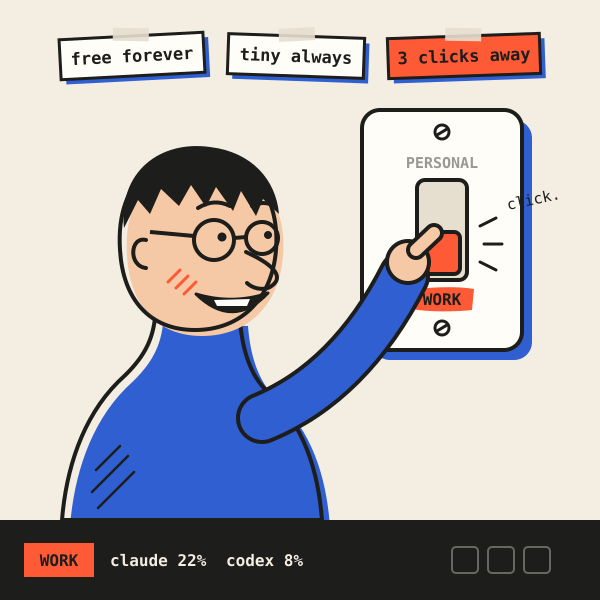
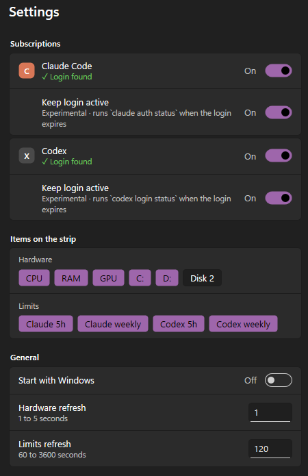

# CCT: Claude Code & Codex account switcher and usage monitor

[](https://github.com/chiarorosa/claude-codex-taskbar/actions/workflows/ci.yml)
[](https://github.com/chiarorosa/claude-codex-taskbar/releases/latest)
[](https://github.com/chiarorosa/claude-codex-taskbar/releases)
[](LICENSE)


<p align="center">
  
</p>

**Personal account or work account? Always know which Claude Code / Codex account you are on, how much of its quota is left, and switch between your accounts in three clicks, right from your taskbar.**

**Platforms:** Windows 11 / 10 today · macOS coming soon · Linux not yet

**Windows version:**


## The problem

Many developers have more than one AI coding subscription: a **personal** Claude or ChatGPT plan and a **work** one paid by their company, sometimes more. In practice:

- You never quite know **which account the CLI is logged in to** right now.
- You find out you were on the **wrong account** only after spending its quota (or your employer's).
- Switching means `/logout`, `/login`, a browser round-trip, and hoping you picked the right one.
- The 5-hour and weekly limits are **per account**, so a number without the account behind it tells you little.

## What CCT does

CCT (`claude-codex-taskbar`) puts the answer where you already look: the taskbar.

1. **Shows the active account's usage.** The 5-hour and weekly limits (% used, reset time) of the account currently logged in to Claude Code and to Codex. Limits belong to the account, not to the app, so the numbers reflect usage from the CLI, the desktop app and the web together.
2. **Tells you which account is active.** A short label of your choice (`P` for personal, `W` for work, up to 5 characters) sits right before the Claude and the Codex gauges, in each service's color, and each saved Claude account has its own. The Claude account menu lists your saved accounts with their email, plan and last-seen usage, and marks the one in use.
3. **Switches accounts in three clicks.** Right-click the strip → **Claude account** → pick one. No `/logout`, no `/login`, no restart: Claude Code uses the new login on its next request.

Plus a CPU, RAM, GPU and per-disk monitor, so you see at a glance whether your PC is under load before you start a big task.

## Three promises

| Promise | What it means |
|---|---|
| **Free and open source, forever** | MIT licensed. No paid tier, no account, no ads, no "pro" version. |
| **Tiny, always** | One native `.exe` under 1 MB, written in Rust (raw Win32 + Direct2D). No runtime, no installer, about 15 MB of RAM and near-zero CPU. |
| **Private and in your hands** | **Zero telemetry, forever**: nothing about you or your usage ever reaches the maintainers. Every account switch is a manual click by you. |

## Within Anthropic's and OpenAI's rules

CCT is a **visibility and convenience tool, not a way around limits**.

- **No automatic switching, ever.** CCT never switches accounts on its own, never rotates accounts when a limit is reached, and never balances load across accounts. Each switch is an explicit action by you. This is a design rule of the project, enforced in code review, not an option you can turn on.
- **Your own accounts only.** CCT is for people who legitimately hold more than one subscription (for example personal and work). Sharing logins or reselling access violates the providers' terms.
- **No token tricks.** CCT never refreshes tokens itself and never competes with the official CLIs; it reuses the login that `claude` and `codex` already saved.
- **Paid plans only for switching.** Only Pro, Max, Team and Enterprise Claude logins can be saved.

## Multiple Claude accounts: how it works

1. While logged in to your first account in Claude Code, right-click the strip → **Claude account → Save current account**.
2. In Claude Code, run `/login` with your second account, then **Save current account** again.
3. From then on, pick an account under **Claude account** to switch.

If a Claude Code task is running or waiting for your answer, CCT asks before switching, because the rest of that task would run on the new account.

Each entry shows the plan and the usage last seen on that account. `⚠ login expires in Nd` warns that a saved login is about to expire; `⚠ needs /login` means it has, so log in with that account and save it again.

**How it is kept safe.** Saved logins are encrypted with Windows DPAPI for your Windows user, in `%APPDATA%\claude-codex-taskbar\accounts\`. A switch holds Claude Code's own lock files, backs up the account being left (so its renewed token is never lost), writes through a temp file, and restores everything if any step fails.

**Scope.** Switching changes the login of the `claude` CLI (`~/.claude/.credentials.json`). The Claude desktop app keeps its own login, so it is not switched. Not supported when `CLAUDE_CONFIG_DIR` is set.

## Features

- **Claude Code limits**: 5-hour and weekly usage; hover for Opus/Sonnet weekly percentages, local reset times and an extra-usage notice.
- **Codex limits**: 5-hour and weekly usage of the current `codex` login, with an offline fallback to the Codex CLI.
- **Claude account switcher**: save paid logins, see which one is active, switch in three clicks.
- **Account labels**: a short tag of your choice (default `P`) before the Claude and Codex gauges; each saved Claude account keeps its own, so the strip shows it after a switch. Edit it in Settings.
- **Hardware**: CPU, RAM, GPU (busiest engine, like Task Manager) and per-disk active time.
- **Quota alerts (opt-in)**: a Windows notification when Claude or Codex usage crosses 80% or 95% (configurable), skipped in full screen and quiet hours.
- **Honest numbers**: an expired login or a broken endpoint shows `—` and the reason, never a fake `0%`.
- **Stays out of your way**: hides in full screen, follows display scaling, light/dark theme and auto-hide, never covers your taskbar icons, survives Explorer restarts and sleep.
- **New Settings window**: styled like the Windows Settings app, follows light/dark mode automatically, and applies every change instantly.
- **English and Brazilian Portuguese**, following the Windows display language.



## Install

1. Download `claude-codex-taskbar-<version>-x64.zip` from the [latest release](https://github.com/chiarorosa/claude-codex-taskbar/releases/latest) and extract it.
2. Put `claude-codex-taskbar.exe` somewhere permanent (for example `%LOCALAPPDATA%\Programs\claude-codex-taskbar\`) and run it. No administrator rights needed.
3. Right-click the strip → **Start with Windows**.

**Requirements:** Windows 11 or Windows 10 (x64), and a logged-in [Claude Code](https://docs.anthropic.com/en/docs/claude-code) and/or Codex CLI on the same Windows user.

Turn off the Windows Widgets button (*Settings → Personalization → Taskbar → Widgets*) and keep taskbar icons centered: the strip lives in that left corner.

Releases are not code-signed yet, so SmartScreen may warn: **More info → Run anyway**. Verify the file against `SHA256SUMS.txt` or its signed build provenance:

```powershell
gh attestation verify claude-codex-taskbar.exe --repo chiarorosa/claude-codex-taskbar
```

Build from source: `cargo build --release` (see [CONTRIBUTING.md](CONTRIBUTING.md)).

## Privacy

- **Zero telemetry.** No analytics, no crash reports, no update checks, nothing sent to the maintainers. Ever.
- **Network access only to the providers' own usage endpoints**, and only for the providers you enable.
- **Credentials stay on your PC.** Read-only, except the Claude login, which is written only when you pick an account to switch to (*Save current account* only reads it). Tokens are never logged, copied or sent anywhere except to their own provider.
- Settings and saved accounts live locally in `%APPDATA%\claude-codex-taskbar\`.

## Roadmap

- **Codex account switcher**, with the same rules: paid plans, manual only, encrypted locally.
- Active account name in the tooltip, for Claude and Codex.
- Windows 10 placement next to the system tray ([#10](https://github.com/chiarorosa/claude-codex-taskbar/issues/10)).
- **macOS** menu-bar version: coming soon.
- **Linux**: not yet.

Not planned: its own login screen, usage history.

## FAQ

### How do I switch between my personal and work Claude Code accounts on Windows?
Save each login once (**Claude account → Save current account**), then switch with three clicks: right-click the strip → **Claude account** → pick one. Both must be paid plans. Claude Code uses the new account from its next request, without a restart.

### How do I know which Claude Code account I am using right now?
Look at the label before the Claude gauges (for example `P` or `W`, set in Settings for each saved account). For details, right-click the strip → **Claude account**: the active account is marked, with its email, plan and usage.

### Is switching accounts allowed by Anthropic?
CCT only automates what you would do by hand with `/logout` and `/login`, for accounts that are yours, and only when you click. It never switches automatically or rotates accounts to get around limits. Make sure your use follows each provider's terms.

### How do I see my Claude Code and Codex usage limits on Windows?
The strip shows the % used of the 5-hour and weekly windows (the same numbers as `/usage` in Claude Code and `/status` in Codex), refreshed every 2 minutes. Hover for reset times.

### Does it need an API key or my password?
No. It reuses the login the official `claude` and `codex` CLIs already saved on your PC.

### Does CCT collect any data?
No. Zero telemetry: the maintainers never receive anything from your copy of CCT.

### How much memory and CPU does it use?
Under 16 MB of memory and near-zero CPU, with no disk or network activity between limit refreshes.


### Does it work on macOS, Linux or Windows 10?
CCT started on Windows 11, where no tool like it existed. A macOS version is coming soon; Linux is not supported yet. On Windows 10 it runs, but the strip stays hidden for now ([#10](https://github.com/chiarorosa/claude-codex-taskbar/issues/10)).

## Disclaimer

CCT is **not affiliated with, endorsed by, or sponsored by Anthropic or OpenAI**. "Claude", "Claude Code", "Codex" and related names are trademarks of their owners. Usage data comes from unofficial, undocumented endpoints (the ones the official CLIs use) that may change at any time; when they do, CCT shows an error instead of wrong numbers.

## Contributing

Bug reports, design feedback, translations, docs and code are all welcome. Read [CONTRIBUTING.md](CONTRIBUTING.md) and the [Code of Conduct](CODE_OF_CONDUCT.md). Security issues: see [SECURITY.md](SECURITY.md).

## License

[MIT](LICENSE) © Pablo Chiaro Rosa
